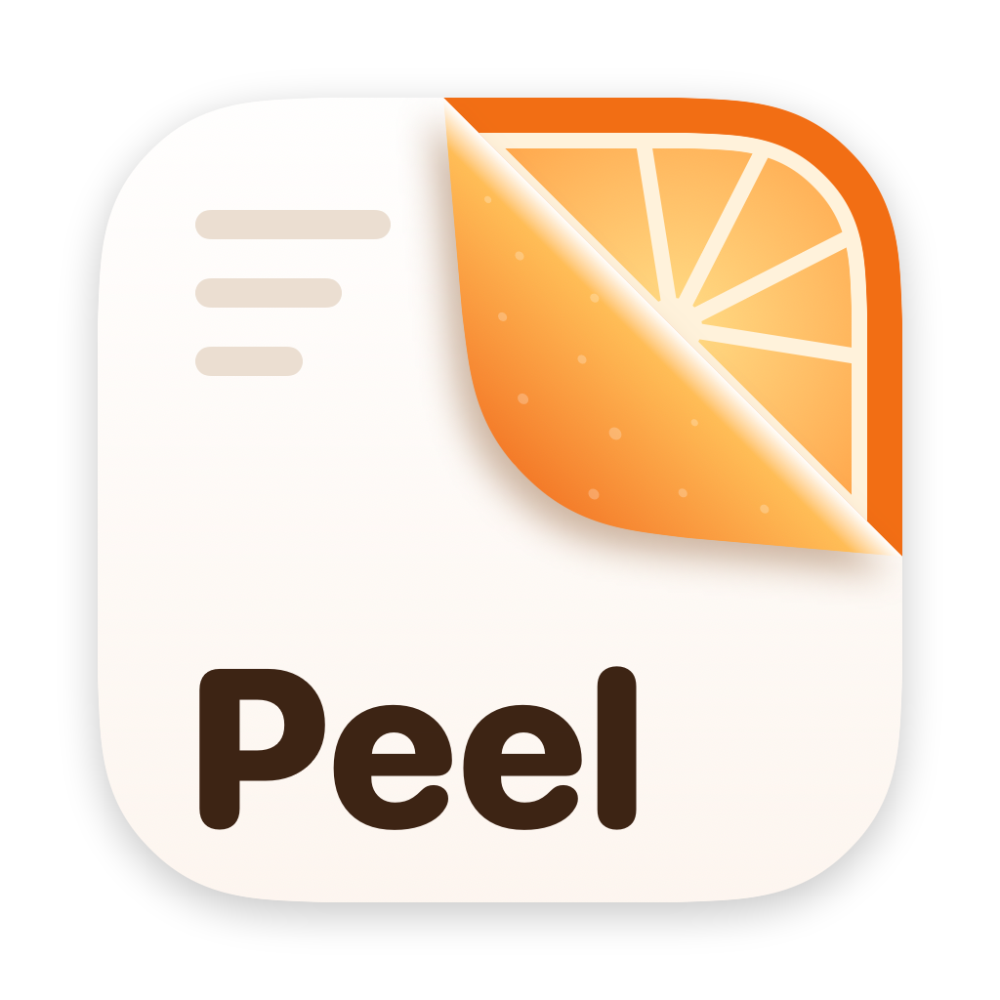
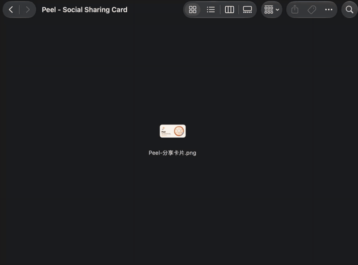
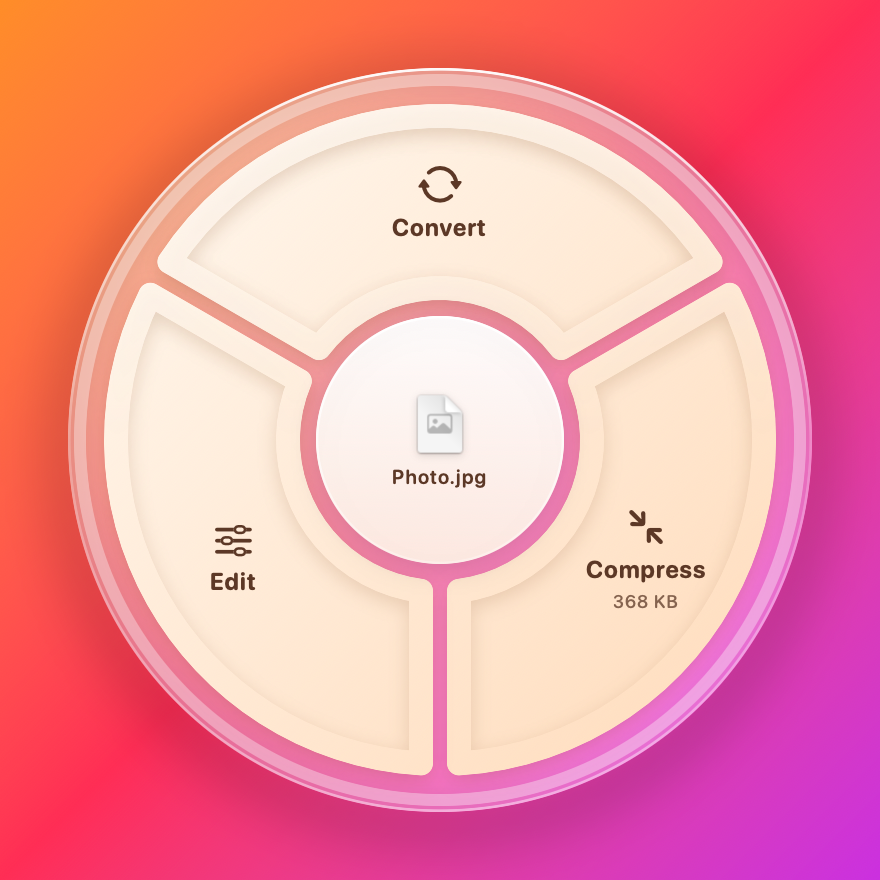
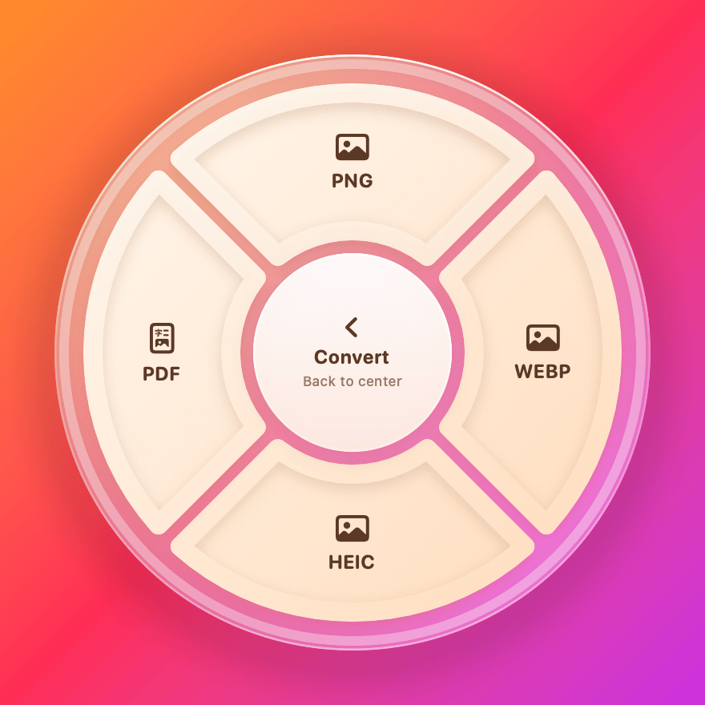
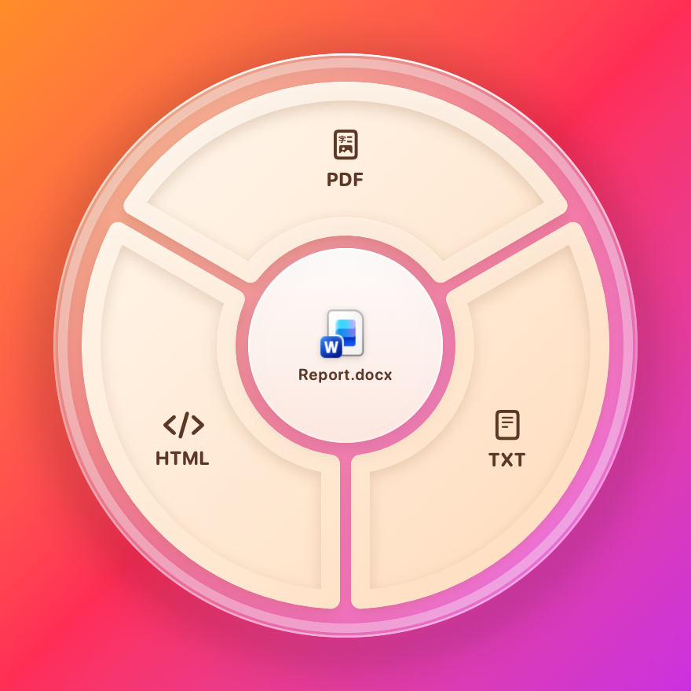
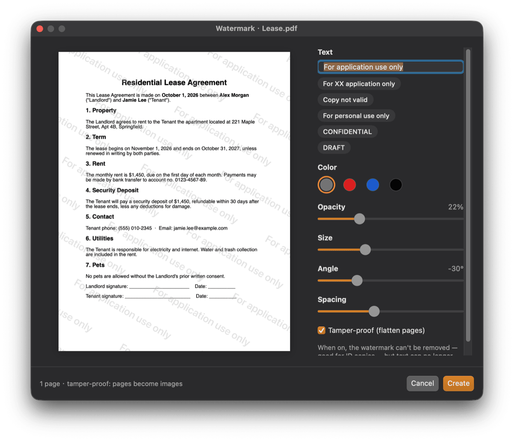
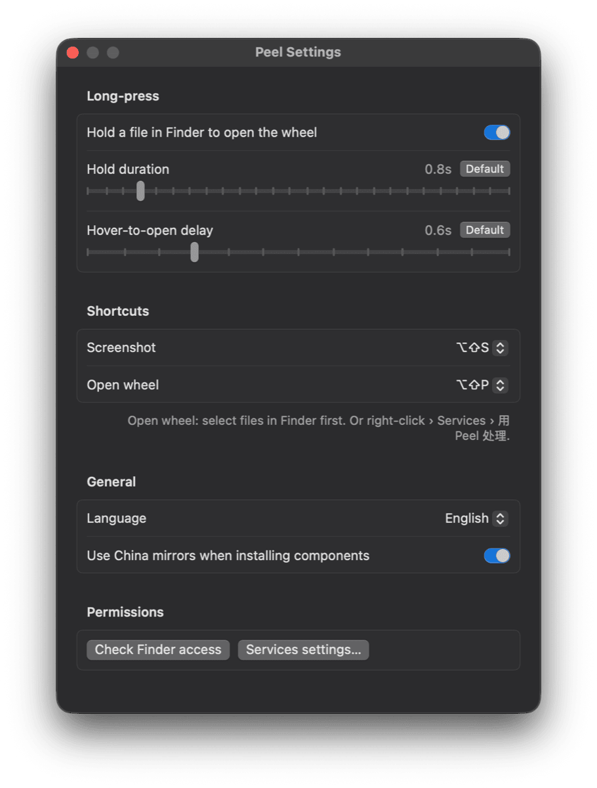

<p align="center">
  
</p>

<h1 align="center">Peel</h1>

<p align="center">
  Press and hold a file in Finder — a wheel pops up — drop it on a sector to convert, compress or edit.<br>
  A tiny macOS menu-bar tool. Everything runs locally.
</p>

<p align="center">
  <a href="README.zh-CN.md">中文说明</a> ·
  <a href="../../releases/latest">Download</a> ·
  <a href="CHANGELOG.md">Changelog</a>
</p>

<p align="center">
  
  <br><sub>Hold a PNG → convert to PDF, then hold the PDF → Compress</sub>
</p>

<p align="center">
  
  
  
</p>

## How it works

1. In Finder, **press and hold** a file (default 1 s, without moving). A wheel appears next to the cursor.
2. Keep holding and **drag onto a sector**, then release. Hover over a category (e.g. *Convert*) to open its sub-wheel; drag back to the center to go up a level.
3. The result is saved **as a copy next to the original** — your original file is never changed.

Moving the mouse within the first second is an ordinary Finder drag, so normal file moves still work.
Select several files first to process them in one go.

**No long-press?** Select files in Finder and press **⌥⇧P**, or right-click › Services › **用 Peel 处理** (Process with Peel).

The wheel only shows what makes sense for that file type — a Word document gets PDF / HTML / TXT, a photo gets Convert / Compress / Edit.

## Features

| | |
|---|---|
| **Documents** | Word / PowerPoint / Excel → PDF (via LibreOffice, fully offline), Pages / Keynote / Numbers export, docx ⇄ txt ⇄ html |
| **PDF** | Compress, compress to a target size, PDF → Word / images, merge, split, rotate, redact (content really removed), metadata, **tiled watermark** (optionally flattened so it can't be removed), **signature** (hand-drawn / typed / saved, optional date) |
| **Images** | Convert (JPG / PNG / HEIC / WebP / PDF), compress, **compress to a target size** (≤ 2 MB / 1 MB / 500 KB / custom), crop, resize, add background, strip location / metadata, **ID photo** (background swap, face-aware framing, common Chinese & visa sizes, optional print sheet), cutout to transparent PNG |
| **Audio & video** | Convert, compress (with size estimate and progress), extract audio, video → GIF |
| **Screenshots** | **⌥⇧S** to select an area → Save (pick a folder) / Copy / Copy Text (on-device OCR) / Pin to screen. Never auto-saved: it only goes to the clipboard unless you save it or drag the thumbnail out |
| **Other** | Zip, Chinese / English UI, settings window (⌘,) for timings and shortcuts |

## Screenshots

<p align="center">
  
  <br><sub>Watermark a PDF or photo with a live preview — optionally flattened so it can't be removed</sub>
</p>

| Sign a PDF | Redact (content is really removed) |
|---|---|
|  |  |

<p align="center">
  
  <br><sub>Settings: hold / hover timings, shortcuts, language</sub>
</p>

## Install

1. Download `Peel-x.y.z.dmg` from [Releases](../../releases/latest) and drag **Peel** into Applications. Works on Apple silicon and Intel, macOS 13 or later.
2. Peel isn't notarized by Apple, so the first launch is blocked. Open **System Settings › Privacy & Security**, scroll down and click **Open Anyway** next to the Peel message.
3. Follow the welcome window to grant permissions (below).
4. Peel offers to install the extra command-line tools it uses in one click (via Homebrew). You can check them anytime under menu-bar icon › Components….

### Permissions

| Permission | Why |
|---|---|
| Accessibility | To tell whether the thing you're holding is a file (not a title bar or sidebar) |
| Automation › Finder | To read which files are selected |
| Screen Recording | Only for screenshots (macOS requires it for every screenshot tool) |

### Optional components

| Tool | Used for | Installed with |
|---|---|---|
| LibreOffice | Word / PPT / Excel conversion | `brew install --cask libreoffice` |
| Ghostscript | PDF compression | `brew install ghostscript` |
| cwebp | WebP output | `brew install webp` |
| pngquant | PNG compression | `brew install pngquant` |
| pdf2docx | PDF → Word | Python venv in `~/Library/Application Support/Peel/venv` |
| FFmpeg | Audio & video | `brew install ffmpeg` |

Everything else (images, PDF editing, OCR, background removal, face detection) uses built-in macOS frameworks.

## Privacy

Peel works entirely on your Mac. Files are never uploaded; OCR, cutouts and ID photos use Apple's on-device Vision framework.
There is no analytics or telemetry. The only network access is when **you** choose to install components (Homebrew / pip downloads).
Logs stay local in `~/Library/Logs/Peel.log`.

## Build from source

Requires the Xcode Command Line Tools (full Xcode not needed).

```bash
./scripts/build_app.sh        # build for this Mac → ~/Applications/Peel.app
open ~/Applications/Peel.app
./scripts/package.sh          # universal DMG → Build/Peel-<version>.dmg
```

Optional: `./scripts/setup_signing.sh` creates a local self-signed certificate so the Accessibility permission survives rebuilds (otherwise ad-hoc signing is used and you re-grant it after each build).

The version lives in `Resources/Info.plist` (`CFBundleShortVersionString`); the build number is set to the build time automatically.
Pushing a tag like `v0.8.0` makes GitHub Actions build the DMG and attach it to a release.

<details>
<summary>Developer test commands</summary>

The binary has a CLI mode that runs features without launching the app:

```bash
P=~/Applications/Peel.app/Contents/MacOS/Peel
$P --do convert:pdf file.docx          # also compress:medium, target:<bytes>, merge, zip, extract:mp3 …
$P --edit wm file.pdf bake             # also sign, crop, resize, idphoto, cutout, split, redact …
$P --ocr image.png
$P --render out.png [--open N] [--hover N] [--en] file…   # render the wheel to an image
```
</details>

### Project layout

```
Sources/Peel/App       entry point, menu bar, settings, CLI test mode
Sources/Peel/Trigger   long-press detection, Finder selection, hotkey & Services entry
Sources/Peel/Wheel     the wheel UI, multi-level navigation, drag & drop
Sources/Peel/Catalog   which sectors each file type gets
Sources/Peel/Engine    converters, compressors, component installer
Sources/Peel/Edit      editor windows (crop, watermark, signature, ID photo …)
Sources/Peel/Snap      screenshots, OCR, pinned images
Sources/Peel/UI        HUD bubble, icon renderer
scripts/               build, package, icon, signing
```

## License

[MIT](LICENSE)
